  

  

  
  
  
  
  

---

### 👋 About me

I build scalable enterprise applications across JavaScript and .NET — and, more recently, the AI agents that automate the work around them. I favor clean, boring architecture, lead cross-functional teams, and ship across REST, GraphQL, microservices and IoT integrations.

- 🚢 **Now:** Software Engineer at **Softship GmbH** (WiseTech Global group), Hamburg, building enterprise liner-shipping software used by 120+ clients worldwide
- 🤖 **Proudest build:** an autonomous **AI bug-tracking agent** (Claude + OpenAI, NestJS orchestration, Python) that cut manual triage by **~50%**
- ⚡ **Performance:** led an AngularJS → Angular/React migration: **~40%** faster load time, **~60%** smaller bundle
- 💼 **Freelance:** delivered many freelance projects alongside full-time roles, end to end from requirements to production
- 🎓 Microsoft certified: **MCP · MCSA · MCSD**
- 🇪🇺 EU Permanent Residence · available immediately for full-time roles and freelance projects

### 🤝 Hire me for freelance work

I'm available for freelance and contract projects, remote or on-site in Hamburg. Typical engagements:

- **Full-stack web apps:** Angular, React or Next.js front ends on .NET or Node.js/NestJS APIs
- **AI agents & LLM integrations:** Claude/OpenAI-powered automation, MCP tools, internal copilots
- **Modernization:** AngularJS → Angular/React migrations, performance tuning, legacy .NET upgrades
- **APIs & integrations:** REST/GraphQL, payments, messaging with RabbitMQ

📬 [Email me](mailto:gopikrishna.gummadidala@gmail.com) or reach out on [LinkedIn](https://linkedin.com/in/gopikrishna-gummadidala).

### 🛠️ Tech I work with

  
   
  

  
  
  
  
  
  
  

### 📊 Skills at a glance

  
  

### 🚀 Featured repos

| Project | What it shows |
| --- | --- |
| [**gopikrishna-portfolio**](https://github.com/GopiKrishnaGummadidala/gopikrishna-portfolio) | My [personal site](https://gopikrishna-gummadidala.vercel.app): Next.js · TypeScript · Tailwind · Framer Motion |
| [**angularJWT-DOTNET-Core**](https://github.com/GopiKrishnaGummadidala/angularJWT-DOTNET-Core) | Token-based auth with ASP.NET Core + Angular |
| [**GroupChat**](https://github.com/GopiKrishnaGummadidala/GroupChat) | Group chat over RabbitMQ in C# |
| [**ngxs-sample**](https://github.com/GopiKrishnaGummadidala/ngxs-sample) | CRUD with NgXS state management in Angular |
| [**RxJs-Angular**](https://github.com/GopiKrishnaGummadidala/RxJs-Angular) | Building Angular apps the reactive way |
| [**ReactExpressApp**](https://github.com/GopiKrishnaGummadidala/ReactExpressApp) | React + Redux client with an Express/MongoDB backend |

### 💬 Ask me about

Production LLM agents · Angular ↔ React migrations · .NET APIs at scale · microservices with RabbitMQ · runtime UI customization frameworks

  

